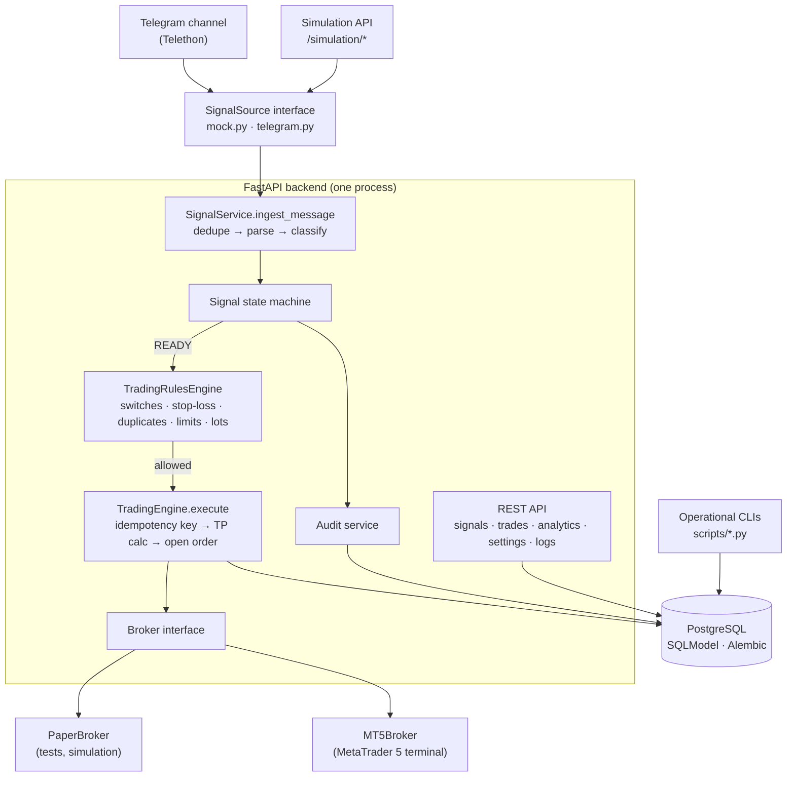
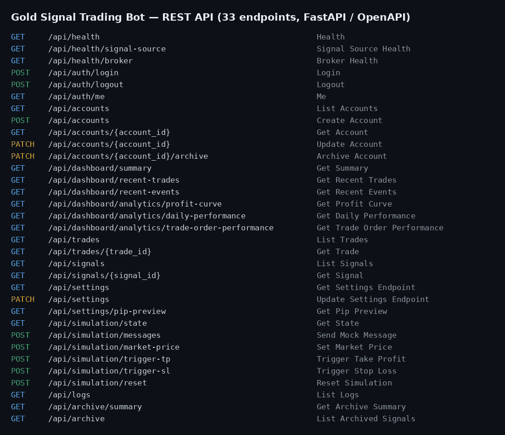
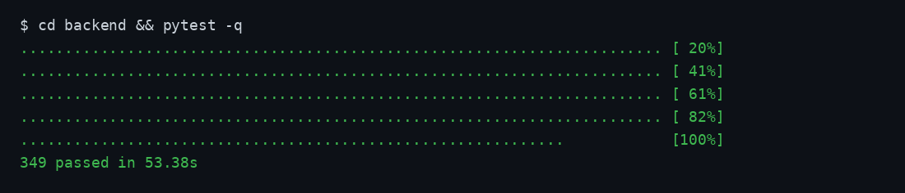

<div align="center">

# Gold Signal Trading Bot

**Telegram signals → parser → state machine → rules engine → broker (Paper / MetaTrader 5)**
A simulation-first trading system in Python (FastAPI), plus a separate copy-trading service with a Next.js dashboard.


[Architecture](#architecture) · [Screenshots](#screenshots) · [Run locally](#run-locally) · [Tests](#tests) · [Docs](docs/)

</div>

> **Live demo:** deployed privately because it controls trading accounts. A walkthrough is available on request.

---

## What it does

Trading signal channels post messages like *"XAUUSD BUY NOW 2315, SL 2305, TP1 2320"* — often split across several messages, edited, or written in different formats. This system:

1. **Ingests** every message from a Telegram channel (Telethon) or from a simulation API.
2. **Parses** it into a structured signal: instrument aliases, BUY/SELL, entry, stop-loss formats, multi-message signals, ambiguity detection.
3. Moves the signal through an explicit **state machine** (`RECEIVED → CLASSIFIED → WAITING_FOR_DETAILS → READY → EXECUTION_PENDING → EXECUTED`, plus `REJECTED / FAILED / EXPIRED / DUPLICATE / IGNORED`).
4. Runs every **trading rule** in order and records a reason code when one fails: auto-trading switch, BUY/SELL enabled, stop-loss required / valid / not too wide, duplicate signal, max open trades, daily trade limit, broker availability, lot size, target and symbol validity, signal expiry.
5. **Executes** through a broker adapter — a deterministic **Paper broker** for development and tests, or **MetaTrader 5** for real accounts — with idempotency per account.
6. Records every decision in an **audit log** and exposes signals, trades, analytics, settings and logs through a REST API (33 endpoints).

**Safety by default:** `TRADING_MODE=SIMULATION`, `AUTO_TRADING=false`, `TELEGRAM_ENABLED=false`, `MT5_ENABLED=false`. No real-money trade can happen unless each one is switched on deliberately.

## Architecture



Two interfaces keep the trading engine independent of any vendor:

- `app/integrations/signal_source/base.py` → `MockSignalSource`, `TelegramSignalSource`
- `app/integrations/broker/base.py` → `PaperBroker`, `MT5Broker`

The engine path is **synchronous on purpose**: the official `MetaTrader5` package is a synchronous C binding and the pipeline is fast, local, CPU-bound work, so a mixed async/sync codebase would add complexity for no benefit. Only Telethon's connection lifecycle is async. Full write-up: [`docs/01-architecture.md`](docs/01-architecture.md).

## Screenshots

**REST API surface** (generated from the live OpenAPI schema)



**Test suite** — `pytest` on the backend



## Tech stack

**Backend:** Python 3.12, FastAPI, Pydantic v2, SQLModel / SQLAlchemy 2, Alembic, PostgreSQL 16 (SQLite in tests), Telethon, MetaTrader5, cryptography (encrypted broker credentials) · **Quality:** pytest, pytest-cov, ruff, mypy · **Infra:** Docker Compose (Postgres), Uvicorn, Windows VPS for the MT5 terminal

## Run locally

```bash
git clone https://github.com/sami7q/gold-signal-trading-bot.git && cd gold-signal-trading-bot

# 1. Database (optional — tests use SQLite)
docker compose up -d

# 2. Backend
cd backend
python -m venv .venv
source .venv/bin/activate          # Windows: .venv\Scripts\activate
pip install -e ".[dev]"
cp ../.env.example ../.env
alembic upgrade head
uvicorn app.main:app --reload      # http://localhost:8000  ·  API docs at /docs

```

Everything runs against the mock signal source and the paper broker until you enable Telegram or MT5 in `.env`.

## Tests

```bash
cd backend
pytest                     # full suite — 349 tests
pytest tests/parser        # message parsing fixtures and scenario sweep
pytest tests/unit          # state machine, credentials, calculations
pytest tests/trading       # rules engine, paper broker, concurrency, reconciliation
pytest tests/integration   # end-to-end simulation scenarios
pytest tests/api           # HTTP tests via FastAPI TestClient
ruff check app tests && mypy app
```

## Documentation

| | |
|---|---|
| [01 Architecture](docs/01-architecture.md) | [08 Testing](docs/08-testing.md) |
| [02 Signal parser](docs/02-signal-parser.md) | [09 Telegram integration](docs/09-telegram-integration.md) |
| [03 Trading engine](docs/03-trading-engine.md) | [10 MT5 integration](docs/10-mt5-integration.md) |
| [04 Paper broker](docs/04-paper-broker.md) | [11 Deployment](docs/11-deployment.md) |
| [05 Database](docs/05-database.md) | [13 Security](docs/13-security.md) |
| [06 API](docs/06-api.md) | [14 Live-readiness checklist](docs/14-live-readiness-checklist.md) |

## Repository layout

```text
backend/     FastAPI app: api · signals · trading · integrations · accounts · analytics · audit · database
  tests/     api · parser · unit · trading · integration · integrations
  scripts/   operational CLIs (account checks, settings audit, signal export, rejection explainer)
dashboard/   Next.js dashboard (currently serving the loco_copy service)
docs/        architecture, parser, engine, deployment, security, operations
loco_copy/   separate service: copies a public Hyperliquid wallet's trades (own venv, DB and tests)
```

> Educational and engineering project. Not financial advice.

---

<div align="center">

Built by **Sami Aqeel** · [LinkedIn](https://www.linkedin.com/in/sami-aqeel/) · [GitHub](https://github.com/sami7q) · sami22eng@gmail.com

</div>
